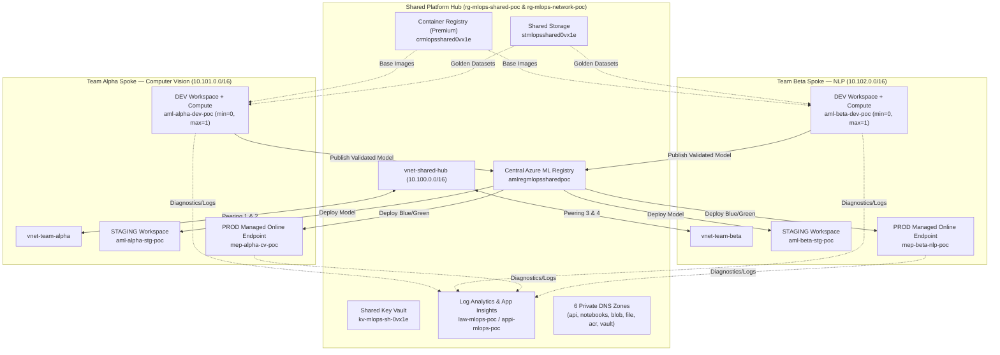

# Enterprise MLOps Platform – Multi-Team CI/CD Governance & Self-Service on Azure ML

Welcome to the **Enterprise MLOps Platform** project. This repository contains the complete Infrastructure-as-Code (Terraform), Machine Learning pipelines (Azure ML & Azure DevOps), Governance policies, and Automated Validation for an enterprise-grade, multi-tenant machine learning environment on Microsoft Azure.

---

## 📌 Project Overview

This platform empowers two independent Data Science teams with fully isolated cloud environments and a centralized shared platform:
1. **Team Alpha (Computer Vision)** — Object detection, image classification (PyTorch CNN).
2. **Team Beta (NLP)** — Sentiment classification, text embeddings (BiLSTM text classifier).

Each team operates across three isolated lifecycle environments:
- **DEV**: Rapid experimentation, model training, and auto-scaling compute (0 to 1 nodes).
- **STAGING**: Automated model evaluation, accuracy gating, and integration testing.
- **PROD**: Zero-downtime Managed Online Endpoints with Blue/Green deployment, manual approval gates, and monitoring.

Both teams leverage a centralized **Shared Platform Subscription** for global model catalogs (Azure ML Registry), container images (ACR), shared datasets (Storage), secrets (Key Vault), and unified observability (Log Analytics & Azure Monitor).

---

## 🏛️ Architecture & Platform Topology



---

## 📁 Repository Structure

```text
Enterprise-MLOps-Platform/
├── docs/                             # Architecture diagrams, design docs & runbooks
│   ├── HANDOVER.md                   # Complete master handover package & runbook
│   ├── architecture-explanation.md   # Architectural breakdown
│   ├── implementation-plan.md        # Step-by-step 10-phase roadmap
│   └── troubleshooting.md            # Issue tracker, root causes & KB index
├── infrastructure/
│   ├── bootstrap/                    # Remote backend state storage (Phase 1)
│   ├── modules/                      # Reusable Terraform modules
│   │   ├── azureml-compute/          # Auto-scaling CPU/GPU compute clusters
│   │   ├── azureml-registry/         # Central Shared Azure ML Registry (AzAPI)
│   │   ├── azureml-workspace/        # Secure Team ML Workspaces
│   │   ├── container-registry/       # Azure Container Registry (Premium)
│   │   ├── key-vault/                # Azure Key Vault with RBAC
│   │   ├── monitoring/               # Log Analytics & Application Insights
│   │   ├── networking/               # VNets, Subnets, NSGs baseline
│   │   ├── private-dns/              # Private DNS Zones & VNet links
│   │   ├── private-endpoint/         # Private Endpoints & DNS groups
│   │   ├── resource-group/           # Azure Resource Groups
│   │   └── storage/                  # Azure Storage Accounts & Containers
│   └── environments/
│       ├── shared/                   # Shared Platform Hub & Services (Phases 2-4)
│       ├── team-alpha/
│       │   ├── dev/                  # DEV Workspace & Compute (Phase 5)
│       │   ├── staging/              # STAGING Workspace (Phase 6)
│       │   └── prod/                 # PROD Workspace & Online Endpoint (Phase 7)
│       └── team-beta/
│           ├── dev/                  # DEV Workspace & Compute (Phase 5)
│           ├── staging/              # STAGING Workspace (Phase 6)
│           └── prod/                 # PROD Workspace & Online Endpoint (Phase 7)
├── ml/                               # Dual-mode Machine Learning workloads
│   ├── team-alpha/                   # Computer Vision (PyTorch CNN)
│   │   ├── config/                   # job.yaml, model-registry.yaml
│   │   ├── environment/              # conda.yaml, requirements.txt
│   │   ├── outputs/model/            # Trained weights, metrics, eval reports
│   │   └── src/                      # train.py, evaluate.py, score.py
│   └── team-beta/                    # NLP (BiLSTM Sentiment Classifier)
│       ├── config/                   # job.yaml, model-registry.yaml
│       ├── environment/              # conda.yaml
│       ├── outputs/model/            # Trained weights, metrics, eval reports
│       └── src/                      # train.py, evaluate.py, score.py
├── pipelines/                        # Azure DevOps YAML CI/CD Pipelines
│   ├── templates/                    # Reusable step templates (train, eval, deploy)
│   ├── team-alpha-pipeline.yml       # Computer Vision 6-stage CI/CD pipeline
│   └── team-beta-pipeline.yml        # NLP 6-stage CI/CD pipeline
├── policies/                         # Azure Policy definitions & assignments
│   ├── definitions/                  # Mandatory tags & PaaS public access block
│   └── assignments/                  # Assignment definitions
├── monitoring/                       # KQL audit queries and Azure Monitor alerts
│   ├── queries/                      # aml_operational_queries.kql
│   └── alerts/                       # metric-alerts.json (Scheduled query alerts)
└── scripts/                          # Utility and validation shell scripts
    └── end-to-end-validation.ps1     # Automated end-to-end verification suite
```

---

## 🗺️ Implementation Phases Status

| Phase | Description | Status | Reference |
| :--- | :--- | :--- | :--- |
| **Phase 0** | **Architecture Understanding & Foundations** | 🟢 **Completed** | [architecture-explanation.md](file:///docs/architecture-explanation.md) |
| **Phase 1** | **Project Setup & Terraform Bootstrap** | 🟢 **Deployed Live** | Storage `stmlopstfdfb9yd` / container `tfstate` |
| **Phase 2** | **Resource Groups & Hub-Spoke Networking** | 🟢 **Deployed Live** | 8 RGs, 3 VNets, 4 Peerings |
| **Phase 3** | **Private DNS & Network Security** | 🟢 **Deployed Live** | 6 Private DNS Zones, 18 VNet Links |
| **Phase 4** | **Shared Platform Services & AML Registry** | 🟢 **Deployed Live** | ACR Premium, Key Vault, Storage, AML Registry, LAW |
| **Phase 5** | **Team Alpha & Beta DEV Workspaces & Compute** | 🟡 **Plan Pre-Saved** | Plans saved in `team-alpha/dev/tfplan` & `team-beta/dev/tfplan` |
| **Phase 6** | **Team Alpha & Beta STAGING Workspaces** | 🟢 **Validated** | `team-alpha/staging` & `team-beta/staging` |
| **Phase 7** | **Team Alpha & Beta PROD & Online Endpoints** | 🟢 **Validated** | AzAPI Online Endpoints `mep-alpha-cv-poc`, `mep-beta-nlp-poc` |
| **Phase 8** | **Machine Learning Workloads (CV & NLP)** | 🟢 **Tested Locally** | PyTorch CNN & BiLSTM dual-mode training, eval, and scoring |
| **Phase 9** | **Azure DevOps CI/CD Pipelines** | 🟢 **Validated** | Multi-stage YAML pipelines & 6 modular templates |
| **Phase 10** | **Monitoring, Governance & End-to-End Testing** | 🟢 **Completed** | 6 KQL queries, ARM alerts, Azure Policies, test script |

---

## 🚀 Quickstart & Resumption Guide

### 1. Prerequisites
- **Azure CLI**: Authenticated (`az login`, `az account set --subscription a22e5b40-a701-4b0e-b937-b43ed360039b`).
- **Terraform**: v1.5+ installed.
- **Python**: 3.10+ with `pyyaml`.

### 2. Unblock Azure Subscription
The Azure subscription `a22e5b40-a701-4b0e-b937-b43ed360039b` currently has `spendingLimit: "On"`. In Azure Portal, go to **Subscriptions** > **Azure subscription 1** > click **Remove spending limit**.

### 3. Deploy Team Alpha DEV & Submit Workload
```powershell
# Apply Team Alpha DEV (6 to add)
cd D:\DevOps\Enterprise-MLOps-Platform\infrastructure\environments\team-alpha\dev
terraform apply "tfplan"

# Submit Computer Vision Training Job
az ml job create --file D:\DevOps\Enterprise-MLOps-Platform\ml\team-alpha\config\job.yaml `
  --resource-group rg-mlops-alpha-dev-poc `
  --workspace-name aml-alpha-dev-poc

# Register Model to Central AML Registry
az ml model create --file D:\DevOps\Enterprise-MLOps-Platform\ml\team-alpha\config\model-registry.yaml `
  --registry-name amlregmlopssharedpoc
```

### 4. Deploy Team Beta DEV & Submit Workload
```powershell
# Apply Team Beta DEV (6 to add)
cd D:\DevOps\Enterprise-MLOps-Platform\infrastructure\environments\team-beta\dev
terraform apply "tfplan"

# Submit NLP Training Job
az ml job create --file D:\DevOps\Enterprise-MLOps-Platform\ml\team-beta\config\job.yaml `
  --resource-group rg-mlops-beta-dev-poc `
  --workspace-name aml-beta-dev-poc

# Register Model to Central AML Registry
az ml model create --file D:\DevOps\Enterprise-MLOps-Platform\ml\team-beta\config\model-registry.yaml `
  --registry-name amlregmlopssharedpoc
```

### 5. Run Automated End-to-End Validation
```powershell
powershell -File scripts/end-to-end-validation.ps1
```

---

## 📖 Complete Handover Documentation

For full technical specifications, FinOps breakdowns, troubleshooting, teardown commands, and deployment checklists, consult:
- **Master Handover Package**: [docs/HANDOVER.md](file:///docs/HANDOVER.md)
- **Troubleshooting Knowledge Base**: [docs/troubleshooting.md](file:///docs/troubleshooting.md)
- **Implementation Roadmap**: [docs/implementation-plan.md](file:///docs/implementation-plan.md)
- **Architecture Deep Dive**: [docs/architecture-explanation.md](file:///docs/architecture-explanation.md)
