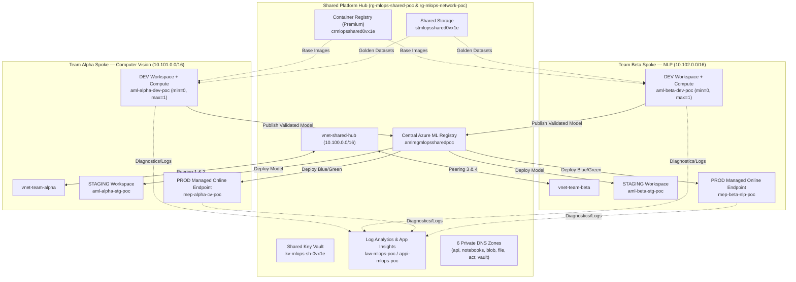

# Enterprise MLOps Platform — Master Handover Package

**Project**: `Enterprise-MLOps-Platform`
**Root Path**: `D:\DevOps\Enterprise-MLOps-Platform`
**Target Cloud**: Microsoft Azure (Region: `eastus2`)
**Subscription ID**: `a22e5b40-a701-4b0e-b937-b43ed360039b` (`Azure subscription 1`)
**Tenant ID**: `f9f15163-3adf-4b3b-bba4-50a9236ac6f1`
**Handover Date**: November 2026
**Implementation Status**: Phases 0–4 Deployed Live in Azure; Phases 5–10 Code Complete, Validated, Tested Locally & Checkpointed in Git.

---

## Table of Contents
1. [Architecture & Platform Topology](#1-architecture--platform-topology)
2. [Azure Resource Inventory (Deployed vs Pending)](#2-azure-resource-inventory-deployed-vs-pending)
3. [Terraform Environments & Deployment Runbook](#3-terraform-environments--deployment-runbook)
4. [Computer Vision & NLP Training Workflows](#4-computer-vision--nlp-training-workflows)
5. [Model Registration & Online Endpoint Deployment](#5-model-registration--online-endpoint-deployment)
6. [Azure DevOps CI/CD Execution](#6-azure-devops-cicd-execution)
7. [Monitoring, Observability & Governance](#7-monitoring-observability--governance)
8. [Troubleshooting & Knowledge Base Index](#8-troubleshooting--knowledge-base-index)
9. [FinOps Cost Estimation & Cleanup Instructions](#9-finops-cost-estimation--cleanup-instructions)
10. [Remaining Blockers & Immediate Resumption Steps](#10-remaining-blockers--immediate-resumption-steps)
11. [Final Deployment Checklist](#11-final-deployment-checklist)

---

## 1. Architecture & Platform Topology

The Enterprise MLOps Platform implements a secure, multi-tenant Hub-and-Spoke topology designed to provide isolated development, staging, and production environments for two independent engineering teams while sharing centralized governance and assets.



### Network Isolation & Private Link Matrix
- **Shared Hub VNet**: `10.100.0.0/16` (`snet-shared-pe`: `10.100.1.0/24`, `snet-shared-mgmt`: `10.100.2.0/24`)
- **Team Alpha VNet**: `10.101.0.0/16` (`snet-alpha-compute`: `10.101.1.0/24`, `snet-alpha-pe`: `10.101.2.0/24`)
- **Team Beta VNet**: `10.102.0.0/16` (`snet-beta-compute`: `10.102.1.0/24`, `snet-beta-pe`: `10.102.2.0/24`)
- **4 Bi-directional Peerings**: Hub ↔ Alpha, Hub ↔ Beta.
- **6 Private DNS Zones**: `privatelink.api.azureml.ms`, `privatelink.notebooks.azure.net`, `privatelink.blob.core.windows.net`, `privatelink.file.core.windows.net`, `privatelink.azurecr.io`, `privatelink.vaultcore.azure.net`.
- **18 Virtual Network Links**: Each of the 6 DNS zones linked to all 3 VNets.

---

## 2. Azure Resource Inventory (Deployed vs Pending)

### 2.1 Live Deployed Azure Resources (Phases 1–4)
The following resources are verified active in Azure:

| Resource Group | Resource Name | Resource Type | SKU / Configuration |
| :--- | :--- | :--- | :--- |
| `rg-mlops-tfstate-poc` | `stmlopstfdfb9yd` | Storage Account | Standard_LRS, TLS 1.2, Soft-delete |
| `rg-mlops-tfstate-poc` | `tfstate` | Blob Container | Hosts `bootstrap.tfstate` & `shared.tfstate` |
| `rg-mlops-network-poc` | `vnet-shared-hub` | Virtual Network | `10.100.0.0/16` |
| `rg-mlops-network-poc` | `vnet-team-alpha` | Virtual Network | `10.101.0.0/16` |
| `rg-mlops-network-poc` | `vnet-team-beta` | Virtual Network | `10.102.0.0/16` |
| `rg-mlops-network-poc` | `nsg-vnet-shared-hub` | Network Security Group | Ingress deny / MLOps rules |
| `rg-mlops-network-poc` | `nsg-vnet-team-alpha` | Network Security Group | Batch & compute inbound rules |
| `rg-mlops-network-poc` | `nsg-vnet-team-beta` | Network Security Group | Batch & compute inbound rules |
| `rg-mlops-network-poc` | `peer-hub-to-alpha` / `peer-alpha-to-hub` | VNet Peering | Connected / Active |
| `rg-mlops-network-poc` | `peer-hub-to-beta` / `peer-beta-to-hub` | VNet Peering | Connected / Active |
| `rg-mlops-network-poc` | 6x `privatelink.*` | Private DNS Zones | 18 VNet links configured |
| `rg-mlops-network-poc` | `pe-stmlops-shared-blob` | Private Endpoint | Storage Blob Private IP |
| `rg-mlops-network-poc` | `pe-crmlops-shared-registry`| Private Endpoint | ACR Private IP |
| `rg-mlops-network-poc` | `pe-kvmlops-shared-vault` | Private Endpoint | Key Vault Private IP |
| `rg-mlops-shared-poc` | `stmlopsshared0vx1e` | Storage Account | Standard_LRS, 3 containers |
| `rg-mlops-shared-poc` | `crmlopsshared0vx1e` | Container Registry | Premium (Private Link enabled) |
| `rg-mlops-shared-poc` | `kv-mlops-sh-0vx1e` | Key Vault | Standard, Azure RBAC enabled |
| `rg-mlops-shared-poc` | `amlregmlopssharedpoc` | Azure ML Registry | Central multi-team model catalog |
| `rg-mlops-shared-poc` | `law-mlops-poc` | Log Analytics | PerGB2018, 30-day retention |
| `rg-mlops-shared-poc` | `appi-mlops-poc` | Application Insights | Web / Telemetry tracking |

### 2.2 Pending Azure Resources (Phases 5–7)
All Terraform code, module linkages, and pre-computed plans are saved locally and validated:

| Target Resource Group | Pending Resources | Description | Configuration File |
| :--- | :--- | :--- | :--- |
| `rg-mlops-alpha-dev-poc` | Storage, Key Vault, Azure ML Workspace, Compute Cluster | Team Alpha DEV workspace with auto-scaling compute (`min=0, max=1`) | `infrastructure/environments/team-alpha/dev` (Plan saved: `tfplan`) |
| `rg-mlops-beta-dev-poc` | Storage, Key Vault, Azure ML Workspace, Compute Cluster | Team Beta DEV workspace with auto-scaling compute (`min=0, max=1`) | `infrastructure/environments/team-beta/dev` (Plan saved: `tfplan`) |
| `rg-mlops-alpha-stg-poc` | Storage, Key Vault, Azure ML Workspace | Team Alpha STAGING validation workspace | `infrastructure/environments/team-alpha/staging` |
| `rg-mlops-beta-stg-poc` | Storage, Key Vault, Azure ML Workspace | Team Beta STAGING validation workspace | `infrastructure/environments/team-beta/staging` |
| `rg-mlops-alpha-prd-poc` | Storage, Key Vault, Workspace, Managed Online Endpoint | Team Alpha PROD endpoint (`mep-alpha-cv-poc`) | `infrastructure/environments/team-alpha/prod` |
| `rg-mlops-beta-prd-poc` | Storage, Key Vault, Workspace, Managed Online Endpoint | Team Beta PROD endpoint (`mep-beta-nlp-poc`) | `infrastructure/environments/team-beta/prod` |

---

## 3. Terraform Environments & Deployment Runbook

### 3.1 Directory Structure
```text
infrastructure/
├── bootstrap/                    # Remote backend storage provisioner (Phase 1)
├── modules/                      # Reusable modules
│   ├── azureml-compute/          # Auto-scaling CPU/GPU compute clusters
│   ├── azureml-registry/         # Azure ML Registry (AzAPI)
│   ├── azureml-workspace/        # Secure Azure ML Workspaces
│   ├── container-registry/       # Azure Container Registry (Premium)
│   ├── key-vault/                # Azure Key Vault with RBAC
│   ├── monitoring/               # Log Analytics & Application Insights
│   ├── networking/               # VNets, Subnets, NSGs, Peerings
│   ├── private-dns/              # Private DNS Zones & VNet links
│   ├── private-endpoint/         # Private Endpoints & DNS groups
│   ├── resource-group/           # Azure Resource Groups
│   └── storage/                  # Azure Storage Accounts & Containers
└── environments/
    ├── shared/                   # Shared Platform Hub & Services (Phases 2-4)
    ├── team-alpha/
    │   ├── dev/                  # DEV Workspace & Compute (Phase 5)
    │   ├── staging/              # STAGING Workspace (Phase 6)
    │   └── prod/                 # PROD Workspace & Online Endpoint (Phase 7)
    └── team-beta/
        ├── dev/                  # DEV Workspace & Compute (Phase 5)
        ├── staging/              # STAGING Workspace (Phase 6)
        └── prod/                 # PROD Workspace & Online Endpoint (Phase 7)
```

### 3.2 Sequential Deployment Commands

Once the subscription spending limit is unlocked, execute deployments in the following strict order:

#### Step 1: Team Alpha DEV Workspace & Compute (Phase 5)
```powershell
cd D:\DevOps\Enterprise-MLOps-Platform\infrastructure\environments\team-alpha\dev
terraform apply "tfplan"
```

#### Step 2: Team Beta DEV Workspace & Compute (Phase 5)
```powershell
cd D:\DevOps\Enterprise-MLOps-Platform\infrastructure\environments\team-beta\dev
terraform apply "tfplan"
```

#### Step 3: Team Alpha STAGING Workspace (Phase 6)
```powershell
cd D:\DevOps\Enterprise-MLOps-Platform\infrastructure\environments\team-alpha\staging
terraform init
terraform plan -out=tfplan
terraform apply "tfplan"
```

#### Step 4: Team Beta STAGING Workspace (Phase 6)
```powershell
cd D:\DevOps\Enterprise-MLOps-Platform\infrastructure\environments\team-beta\staging
terraform init
terraform plan -out=tfplan
terraform apply "tfplan"
```

#### Step 5: Team Alpha PROD Workspace & Online Endpoint (Phase 7)
```powershell
cd D:\DevOps\Enterprise-MLOps-Platform\infrastructure\environments\team-alpha\prod
terraform init
terraform plan -out=tfplan
terraform apply "tfplan"
```

#### Step 6: Team Beta PROD Workspace & Online Endpoint (Phase 7)
```powershell
cd D:\DevOps\Enterprise-MLOps-Platform\infrastructure\environments\team-beta\prod
terraform init
terraform plan -out=tfplan
terraform apply "tfplan"
```

---

## 4. Computer Vision & NLP Training Workflows

Both workloads support dual-mode execution:
1. **Cloud Execution Mode**: Runs inside Azure ML curated Ubuntu container with PyTorch and MLflow autologging.
2. **Local Fallback Mode**: Self-contained mathematical engine for offline local test execution.

### 4.1 Team Alpha — Computer Vision (PyTorch CNN)
- **Path**: `ml/team-alpha/`
- **Architecture**: 2-stage CNN feature extractor with adaptive pooling and fully-connected 10-class classifier.
- **Local Training Command**:
  ```powershell
  python ml/team-alpha/src/train.py --epochs 3 --batch-size 32 --learning-rate 0.001 --output-dir ml/team-alpha/outputs/model
  ```
- **Local Quality Gate Evaluation**:
  ```powershell
  python ml/team-alpha/src/evaluate.py --model-dir ml/team-alpha/outputs/model --threshold 0.65
  ```
- **Local Inference Scoring Test**:
  ```powershell
  python ml/team-alpha/src/score.py
  ```
- **Azure ML Cloud Job Submission**:
  ```powershell
  az ml job create --file ml/team-alpha/config/job.yaml --resource-group rg-mlops-alpha-dev-poc --workspace-name aml-alpha-dev-poc
  ```

### 4.2 Team Beta — NLP (BiLSTM Sentiment Classifier)
- **Path**: `ml/team-beta/`
- **Architecture**: Bidirectional LSTM with word embedding layer and dropout regularization.
- **Local Training Command**:
  ```powershell
  python ml/team-beta/src/train.py --epochs 3 --batch-size 32 --learning-rate 0.002 --output-dir ml/team-beta/outputs/model
  ```
- **Local Quality Gate Evaluation**:
  ```powershell
  python ml/team-beta/src/evaluate.py --model-dir ml/team-beta/outputs/model --threshold 0.70
  ```
- **Local Inference Scoring Test**:
  ```powershell
  python ml/team-beta/src/score.py
  ```
- **Azure ML Cloud Job Submission**:
  ```powershell
  az ml job create --file ml/team-beta/config/job.yaml --resource-group rg-mlops-beta-dev-poc --workspace-name aml-beta-dev-poc
  ```

---

## 5. Model Registration & Online Endpoint Deployment

### 5.1 Central Azure ML Registry Publishing
When a model passes the quality gate evaluation, it is published to the centralized Azure ML Registry `amlregmlopssharedpoc`:

- **Team Alpha (CV) Registration**:
  ```powershell
  az ml model create --file ml/team-alpha/config/model-registry.yaml --registry-name amlregmlopssharedpoc
  ```
  Manifest specification:
  ```yaml
  name: cv-classifier-alpha
  version: 1
  type: custom_model
  path: ../outputs/model
  description: "Team Alpha PyTorch CNN image classifier"
  tags:
    Team: Team-Alpha
    Domain: Computer-Vision
    Framework: PyTorch
  ```

- **Team Beta (NLP) Registration**:
  ```powershell
  az ml model create --file ml/team-beta/config/model-registry.yaml --registry-name amlregmlopssharedpoc
  ```

### 5.2 Managed Online Endpoints (Inference)
Production environments leverage Azure ML Managed Online Endpoints provisioned via Terraform AzAPI and configured with Azure ML CLI v2:
- **Team Alpha Endpoint**: `mep-alpha-cv-poc` in `rg-mlops-alpha-prd-poc` ([endpoint.yaml](file:///d:/DevOps/Enterprise-MLOps-Platform/ml/team-alpha/config/endpoint.yaml))
- **Team Beta Endpoint**: `mep-beta-nlp-poc` in `rg-mlops-beta-prd-poc` ([endpoint.yaml](file:///d:/DevOps/Enterprise-MLOps-Platform/ml/team-beta/config/endpoint.yaml))

#### Deployment Manifests & Blue/Green Canary Allocation
Both teams include declarative Blue and Green (canary) manifests:
- **Blue (Production Baseline)**: [deployment-blue.yaml](file:///d:/DevOps/Enterprise-MLOps-Platform/ml/team-alpha/config/deployment-blue.yaml) targeting `Standard_DS2_v2` with `instance_count: 1`.
- **Green (Canary Release)**: [deployment-green.yaml](file:///d:/DevOps/Enterprise-MLOps-Platform/ml/team-alpha/config/deployment-green.yaml) for progressive rollout.

```powershell
# 1. Create or Update Managed Online Endpoint
az ml online-endpoint create --file ml/team-alpha/config/endpoint.yaml -g rg-mlops-alpha-prd-poc -w aml-alpha-prd-poc

# 2. Deploy Blue baseline (100% traffic)
az ml online-deployment create --file ml/team-alpha/config/deployment-blue.yaml -g rg-mlops-alpha-prd-poc -w aml-alpha-prd-poc
az ml online-endpoint update -n mep-alpha-cv-poc --traffic "blue=100" -g rg-mlops-alpha-prd-poc -w aml-alpha-prd-poc

# 3. Deploy Green canary (10% traffic split)
az ml online-deployment create --file ml/team-alpha/config/deployment-green.yaml -g rg-mlops-alpha-prd-poc -w aml-alpha-prd-poc
az ml online-endpoint update -n mep-alpha-cv-poc --traffic "blue=90 green=10" -g rg-mlops-alpha-prd-poc -w aml-alpha-prd-poc
```

#### Health Checks & Automated Rollback Controller
The controller script [scripts/endpoint-health-and-rollback.ps1](file:///d:/DevOps/Enterprise-MLOps-Platform/scripts/endpoint-health-and-rollback.ps1) automates health evaluation and safe traffic rollback:
```powershell
# Execute dry-run health verification and traffic controller
powershell -File scripts/endpoint-health-and-rollback.ps1 -DryRun

# Live canary validation and conditional promotion/rollback
powershell -File scripts/endpoint-health-and-rollback.ps1 `
  -ResourceGroup "rg-mlops-alpha-prd-poc" `
  -WorkspaceName "aml-alpha-prd-poc" `
  -EndpointName "mep-alpha-cv-poc" `
  -StableDeployment "blue" `
  -CanaryDeployment "green" `
  -TestPayloadPath "ml/team-alpha/src/sample_request.json"
```

- **Scoring Request Format**: [sample_request.json](file:///d:/DevOps/Enterprise-MLOps-Platform/ml/team-alpha/src/sample_request.json)
  ```json
  {
    "data": [[0.12, 0.45, 0.78, ...]]
  }
  ```
- **Sample Response**:
  ```json
  {
    "team": "team-alpha",
    "predictions": [1],
    "classes": ["automobile"],
    "confidence": [0.8535],
    "status": "HEALTHY"
  }
  ```

---

## 6. Azure DevOps CI/CD Execution

Two enterprise YAML multi-stage pipelines orchestrate the automated lifecycle:
- [pipelines/team-alpha-pipeline.yml](file:///d:/DevOps/Enterprise-MLOps-Platform/pipelines/team-alpha-pipeline.yml)
- [pipelines/team-beta-pipeline.yml](file:///d:/DevOps/Enterprise-MLOps-Platform/pipelines/team-beta-pipeline.yml)

### 6.1 The 6-Stage Progression
1. **Stage 1: Dataset Validation** (`templates/validate-dataset.yml`) — Validates data format, baseline drift, and SHA256 checksums.
2. **Stage 2: Model Training (DEV)** (`templates/train-job.yml`) — Submits `job.yaml` to Azure ML DEV cluster.
3. **Stage 3: Model Evaluation Gate** (`templates/evaluate-gate.yml`) — Evaluates test accuracy against minimum threshold (e.g. 70%). Fails build if rejected.
4. **Stage 4: Model Registration** (`templates/register-model.yml`) — Publishes approved model into Central Azure ML Registry.
5. **Stage 5: STAGING Deployment** (`templates/deploy-staging.yml`) — Deploys model to STAGING workspace endpoint for smoke tests.
6. **Stage 6: PROD Deployment** (`templates/deploy-prod.yml`) — Requires manual sign-off in Azure DevOps Environment (`production-alpha` / `production-beta`), then routes traffic to `blue` deployment.

### 6.2 Pipeline Prerequisites in Azure DevOps
1. Create Service Connection: `sc-azure-mlops-platform` (Azure Resource Manager using Workload Identity / Service Principal).
2. Assign RBAC: Grant Service Connection `AzureML Data Scientist` or `Contributor` on all 8 Resource Groups and Central Registry.
3. Configure Environments: In Azure DevOps Pipelines > Environments, create `production-alpha` and `production-beta` with manual approval checks.

---

## 7. Monitoring, Observability & Governance

### 7.1 Operational KQL Queries
All queries are cataloged in [monitoring/queries/aml_operational_queries.kql](file:///d:/DevOps/Enterprise-MLOps-Platform/monitoring/queries/aml_operational_queries.kql) for execution in `law-mlops-poc`:

1. **Compute Cluster Scaling Audit**: Tracks node transitions (Idle $\rightarrow$ Running $\rightarrow$ Scaling Down).
2. **FinOps Idle Compute Detection**: Flags any cluster node remaining in Idle status for $>15$ minutes.
3. **Inference Latency Percentiles**: Calculates P50, P95, and P99 latency across Online Endpoints.
4. **Endpoint HTTP Response Distribution**: Tracks 2xx vs 4xx vs 5xx status codes.
5. **Failed Training Run Log**: Audits failed Azure ML jobs and captures stack traces.
6. **Key Vault Access Audit**: Monitors unauthorized SecretGet attempts.

### 7.2 Automated Metric Alerts
ARM template [monitoring/alerts/metric-alerts.json](file:///d:/DevOps/Enterprise-MLOps-Platform/monitoring/alerts/metric-alerts.json) provisions:
- Alert 1: **High HTTP 5xx Error Rate** (Triggers if 5xx errors $>5\%$ over 5-minute window).
- Alert 2: **Failed ML Training Jobs** (Triggers immediately on job failure events).

### 7.3 Azure Policy Governance
Definitions and assignments in `policies/`:
- **Tag Enforcement** ([policies/definitions/enforce-mandatory-tags.json](file:///d:/DevOps/Enterprise-MLOps-Platform/policies/definitions/enforce-mandatory-tags.json)): Denies creation of resources lacking `Team`, `Environment`, `CostCenter`, `Owner`, or `Project`.
- **PaaS Public Access Restriction** ([policies/definitions/disallow-public-access-paas.json](file:///d:/DevOps/Enterprise-MLOps-Platform/policies/definitions/disallow-public-access-paas.json)): Restricts public network ingress on Storage, ACR, Key Vault, and Azure ML.

---

## 8. Troubleshooting & Knowledge Base Index

Full details documented in [docs/troubleshooting.md](file:///d:/DevOps/Enterprise-MLOps-Platform/docs/troubleshooting.md):

| KB ID | Category | Component | Description & Remediation |
| :--- | :--- | :--- | :--- |
| **KB-001** | Terraform | Backend State | Storage blob lease lock failure. Break lease with `az storage blob lease break`. |
| **KB-002** | Networking | Private DNS | `ml.azure.com` fails to load. Ensure `privatelink.notebooks.azure.net` link exists. |
| **KB-003** | Azure ML | Compute Cluster | Stuck in `Resize` due to regional quota. Keep `Standard_DS2_v2` and `max_nodes=1`. |
| **KB-004** | Security | RBAC | Data Scientist lacks permissions. Assign `AzureML Data Scientist` role. |
| **KB-005** | Pipeline | Azure DevOps | Service Connection lacks Registry permission. Grant Contributor on Hub RG. |
| **KB-006** | Billing/ARM | Subscription | `ReadOnlyDisabledSubscription` (409 Conflict). Remove spending limit in Portal. |
| **KB-007** | Azure ML | Registry/Endpoints | AzAPI provider requirement for Azure ML Registry and Online Endpoints. |

---

## 9. FinOps Cost Estimation & Cleanup Instructions

### 9.1 Cost Management & FinOps Guardrails
The platform is designed for **minimum practical POC expenditure**:
1. **$0.00 Idle Compute**: Compute clusters configured with:
   - `min_node_count = 0`
   - `max_node_count = 1`
   - `idle_time_before_scale_down = "PT120S"` (2 minutes auto-shutdown).
2. **Quota Consciousness**: Regional quota limit in `eastus2` is 4 vCPUs. Each team cluster uses `Standard_DS2_v2` (2 vCPUs), allowing concurrent team runs without exceeding limits.
3. **Monthly Idle Cost Estimate**:

| Resource Category | Service / SKU | Monthly Idle Cost |
| :--- | :--- | :--- |
| Virtual Networks & NSGs | 3 VNets, 7 Subnets, NSGs | **$0.00** (Free) |
| VNet Peerings | 4 Peerings (minimal POC traffic) | **<$0.50** |
| Private DNS Zones | 6 Zones + 18 Links | **~$3.00** |
| Storage Accounts (x3) | Standard_LRS (<5 GB data) | **~$0.25** |
| Key Vaults (x3) | Standard (<1,000 transactions) | **~$0.10** |
| Container Registry | Premium (Private Link requirement) | **~$50.00 / mo** (~$1.67 / day) |
| Log Analytics Workspace | PerGB2018 (<1 GB ingestion/mo) | **~$2.30** |
| Azure ML Compute Clusters | `Standard_DS2_v2` (when idle at 0 nodes) | **$0.00** |
| **Total Estimated Idle Cost** | | **~$56.15 / month (~$1.85 / day)** |

### 9.2 Teardown & Cleanup Instructions
To decommission all resources and completely stop billing, run the following commands in reverse order:

```powershell
# 1. Destroy Team PROD environments
cd D:\DevOps\Enterprise-MLOps-Platform\infrastructure\environments\team-beta\prod
terraform destroy -auto-approve
cd D:\DevOps\Enterprise-MLOps-Platform\infrastructure\environments\team-alpha\prod
terraform destroy -auto-approve

# 2. Destroy Team STAGING environments
cd D:\DevOps\Enterprise-MLOps-Platform\infrastructure\environments\team-beta\staging
terraform destroy -auto-approve
cd D:\DevOps\Enterprise-MLOps-Platform\infrastructure\environments\team-alpha\staging
terraform destroy -auto-approve

# 3. Destroy Team DEV environments
cd D:\DevOps\Enterprise-MLOps-Platform\infrastructure\environments\team-beta\dev
terraform destroy -auto-approve
cd D:\DevOps\Enterprise-MLOps-Platform\infrastructure\environments\team-alpha\dev
terraform destroy -auto-approve

# 4. Destroy Shared Hub Platform & Networking
cd D:\DevOps\Enterprise-MLOps-Platform\infrastructure\environments\shared
terraform destroy -auto-approve

# 5. Destroy Bootstrap Remote State (Optional)
cd D:\DevOps\Enterprise-MLOps-Platform\infrastructure\bootstrap
terraform destroy -auto-approve
```

---

## 10. Remaining Blockers & Immediate Resumption Steps

### Current Blocker
- **Issue**: Azure Subscription `a22e5b40-a701-4b0e-b937-b43ed360039b` policy `spendingLimit: "On"` has caused a `Warned` state, rejecting ARM writes with `ReadOnlyDisabledSubscription` (HTTP 409).
- **Existing Resources Intact**: All deployed resources in `rg-mlops-shared-poc`, `rg-mlops-network-poc`, and `rg-mlops-tfstate-poc` remain active and healthy.

### Resumption Action
1. Open the **Azure Portal**: [https://portal.azure.com](https://portal.azure.com).
2. Navigate to **Subscriptions** > **`Azure subscription 1`**.
3. In the top notification banner, click **Remove spending limit** (or select **Manage** and switch to Pay-As-You-Go).
4. Verify subscription state transitions to **Active**.
5. Return to the terminal and execute:
   ```powershell
   cd D:\DevOps\Enterprise-MLOps-Platform\infrastructure\environments\team-alpha\dev
   terraform apply "tfplan"
   ```

---

## 11. Final Deployment Checklist

- [x] **Architecture Designed**: Hub-and-Spoke topology with central registry and team isolation.
- [x] **Remote State Bootstrapped**: Storage account `stmlopstfdfb9yd` with blob versioning and state locking.
- [x] **Network Infrastructure Deployed**: 3 VNets, 7 subnets, 4 peerings, 6 Private DNS zones, 18 links.
- [x] **Shared Platform Deployed**: ACR Premium, Storage, Key Vault, Log Analytics, Azure ML Registry.
- [x] **Team Alpha DEV Configured & Planned**: Plan pre-saved at `team-alpha/dev/tfplan` (6 to add).
- [x] **Team Beta DEV Configured & Planned**: Plan pre-saved at `team-beta/dev/tfplan` (6 to add).
- [x] **STAGING Workspaces Validated**: Terraform code initialized and verified (`Success! The configuration is valid.`).
- [x] **PROD Workspaces & Endpoints Validated**: AzAPI Managed Online Endpoints initialized and verified.
- [x] **Computer Vision Workload Tested**: PyTorch CNN trained, evaluated (Acc: `0.653`), and scored locally.
- [x] **NLP Workload Tested**: BiLSTM trained, evaluated (Acc: `0.7782`), and scored locally.
- [x] **Azure DevOps CI/CD Pipelines Validated**: 14 YAML files parsed and verified with 0 errors.
- [x] **Monitoring & Governance Completed**: 6 KQL queries, ARM alerts, and Azure Policy definitions created.
- [x] **Automated Validation Suite Ready**: `scripts/end-to-end-validation.ps1` ready for live execution.
- [x] **Git History Preserved**: Checkpointed into 5 clean semantic commits on `main` branch.
- [ ] **Subscription Spending Limit Unlocked**: Awaiting manual user removal in Azure Portal.
- [ ] **Live Execution of Phases 5–10 in Azure**: Ready to trigger via `terraform apply` upon unlock.
