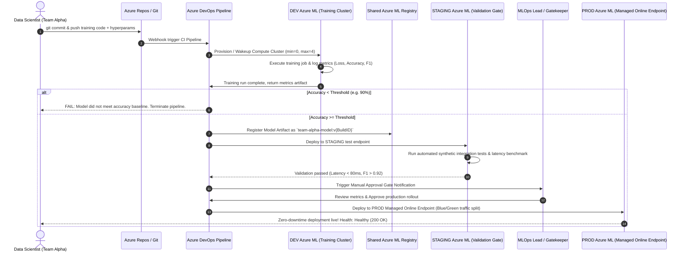

# Enterprise MLOps Platform – Architecture Deep Dive

## 1. Executive Summary & Problem Statement

In many modern enterprises, Data Science teams work in silos.
- Team Alpha (Computer Vision) and Team Beta (NLP) create their own storage accounts, separate container registries, and unmonitored compute resources.
- Result: **Massive cost leaks, security compliance failures (public endpoints open to the internet), untracked model deployments, and lack of audit trails**.

### The Solution: Multi-Team Governed MLOps Platform
This architecture establishes:
1. **Centralized Platform Governance**: A single Shared Platform hosting core assets (Central Azure ML Registry, golden container images, centralized datasets, Key Vault, and unified Log Analytics).
2. **Decentralized Team Autonomy**: Team Alpha and Team Beta have isolated workspaces for DEV, STAGING, and PROD, ensuring complete blast radius protection.
3. **Strict Network Isolation**: All services communicate via Customer-Managed Virtual Networks and Azure Private Endpoints without public internet exposure.
4. **Automated Promotion Lifecycles**: Git commit → DEV Training → STAGING Validation & Quality Gates → Manual Approval Gate → PROD Online Managed Endpoint.

---

## 2. Architecture Diagram & Component Overview

```mermaid
graph TB
    subgraph Corporate_Network ["Secure Corporate Network / Azure DevOps Agents"]
        ADO["Azure DevOps Agent Pool<br/>(Self-Hosted / Managed)"]
        Engineer["Data Scientist / MLOps Engineer"]
    end

    subgraph Hub_VNet ["Shared Platform VNet (10.100.0.0/16)"]
        subgraph Subnet_Shared_PE ["Private Endpoint Subnet (10.100.1.0/24)"]
            PE_Reg["PE: Azure ML Registry"]
            PE_ACR["PE: Shared ACR"]
            PE_ST["PE: Shared Storage"]
            PE_KV["PE: Shared Key Vault"]
        end
        subgraph Subnet_Shared_Mon ["Monitoring & Log Analytics"]
            LAW["Central Log Analytics Workspace"]
            AZ_Mon["Azure Monitor & Cost Alerts"]
        end
    end

    subgraph Spoke_Alpha ["Team Alpha VNet / Subnets (10.101.0.0/16)"]
        subgraph Alpha_DEV_Env ["DEV Environment (10.101.1.0/24)"]
            Alpha_DEV_WS["Azure ML DEV Workspace"]
            Alpha_DEV_CC["Compute Cluster<br/>(Min: 0, Max: 4 Nodes)"]
        end
        subgraph Alpha_STG_Env ["STAGING Environment (10.101.2.0/24)"]
            Alpha_STG_WS["Azure ML STAGING Workspace"]
            Alpha_STG_Val["Validation Jobs & Gating"]
        end
        subgraph Alpha_PRD_Env ["PROD Environment (10.101.3.0/24)"]
            Alpha_PRD_WS["Azure ML PROD Workspace"]
            Alpha_PRD_EP["Managed Online Endpoint<br/>(Blue/Green Deployment)"]
        end
    end

    subgraph Spoke_Beta ["Team Beta VNet / Subnets (10.102.0.0/16)"]
        subgraph Beta_DEV_Env ["DEV Environment (10.102.1.0/24)"]
            Beta_DEV_WS["Azure ML DEV Workspace"]
            Beta_DEV_CC["Compute Cluster<br/>(Min: 0, Max: 4 Nodes)"]
        end
        subgraph Beta_STG_Env ["STAGING Environment (10.102.2.0/24)"]
            Beta_STG_WS["Azure ML STAGING Workspace"]
            Beta_STG_Val["Validation Jobs & Gating"]
        end
        subgraph Beta_PRD_Env ["PROD Environment (10.102.3.0/24)"]
            Beta_PRD_WS["Azure ML PROD Workspace"]
            Beta_PRD_EP["Managed Online Endpoint<br/>(Blue/Green Deployment)"]
        end
    end

    Engineer -->|Git Push & PR| ADO
    ADO -->|Trigger Training Job| Alpha_DEV_WS
    ADO -->|Trigger Training Job| Beta_DEV_WS

    Alpha_DEV_CC -.->|Fetch Golden Image| PE_ACR
    Beta_DEV_CC -.->|Fetch Golden Image| PE_ACR

    Alpha_DEV_CC -.->|Fetch Golden Data| PE_ST
    Beta_DEV_CC -.->|Fetch Golden Data| PE_ST

    Alpha_DEV_WS -->|Register Evaluated Model| PE_Reg
    Beta_DEV_WS -->|Register Evaluated Model| PE_Reg

    Alpha_STG_WS -.->|Pull Registered Model| PE_Reg
    Alpha_PRD_EP -.->|Deploy Promoted Model| PE_Reg

    Beta_STG_WS -.->|Pull Registered Model| PE_Reg
    Beta_PRD_EP -.->|Deploy Promoted Model| PE_Reg

    Hub_VNet <--->|VNet Peering| Spoke_Alpha
    Hub_VNet <--->|VNet Peering| Spoke_Beta
```

---

## 3. Simple Intuition (English + Hindi)

> **Architectural Metaphor (हिंदी में समझें):**
>
> Socho ek **Airport aur Airlines** ka model:
> - **Shared Platform** ek International Airport ka Central Runway, Control Tower, Fuel Depot, aur Security Check hai. Har airline ko apna naya airport banane ki zaroorat nahi hai.
> - **Team Alpha (Indigo Airlines / Computer Vision)** aur **Team Beta (Air India / NLP)** alag-alag companies hain. Unke apne pilots (Data Scientists), apne aircrafts (Compute Clusters), aur apne passenger gates (PROD Endpoints) hain.
> - **Azure ML Registry** ek central catalog/hangar hai: Jahan se approved plane design (trained ML model) inspect hokar release hota hai.
> - **Private Endpoints**: Saari internal bus aur transport underground private tunnels (VNet) ke through chalegi, public roads (Internet) par koi bhi sensitive asset nahi ghoomega.

---

## 4. How Teams Use Central Shared Services

| Shared Service | How Team Alpha & Beta Consume It | Benefits & Security Governance |
| :--- | :--- | :--- |
| **Azure ML Registry** | Models & Environment definitions are published here once validated in DEV. Workspaces in STAGING & PROD pull models directly using registry URIs: `azureml://registries/<name>/models/<model-name>/versions/<ver>`. | Eliminates copying weights across workspaces; gives centralized model lineage, versioning, and compliance tagging. |
| **Azure Container Registry (ACR)** | Base Docker images with pre-installed CUDA, PyTorch, Hugging Face transformers, and optimized inference servers (Triton/TorchServe) are pushed here by the Platform Team. | Guarantees all team models run on patched, security-scanned, approved base images. |
| **Shared Storage Account** | Golden reference datasets (e.g., standard evaluation datasets, benchmark benchmarks) are mounted read-only. | Prevents redundant copies of multi-terabyte datasets across teams, saving immense storage costs. |
| **Azure Key Vault** | Stores centralized credentials (external API keys, service principal tokens, third-party licensing). | Zero hardcoded credentials in ML scripts or repositories. Workspaces access via Managed Identity. |
| **Log Analytics & Monitor** | All workspaces, training cluster stdout/stderr, inference HTTP access logs, and audit logs stream to this workspace. | Single pane of glass for Security & FinOps teams to run KQL queries, track GPU utilization, and alert on inference errors. |

---

## 5. End-to-End DEV → STAGING → PROD Lifecycle

### Detailed Lifecycle Phases:
1. **DEV (Experimentation & Training)**:
   - Data scientists test hypothesis. Compute cluster nodes are set to `min_instances = 0`.
   - Node auto-scales to `1` or `2` when a job starts, and scales down to `0` after 120 seconds of idle time.
   - Cost is minimized: **You only pay for compute while training is actively executing.**
2. **STAGING (Evaluation & Quality Gates)**:
   - Automated smoke tests ensure the model container starts cleanly.
   - Inference latency, memory footprint, and model drift metrics are checked against automated thresholds.
3. **PROD (High Availability & Governance)**:
   - Deployed on **Azure ML Managed Online Endpoint**.
   - Supports blue-green deployment (e.g., 90% traffic to existing v1, 10% traffic to candidate v2).
   - Monitored by Azure Monitor alert rules (HTTP 5xx rate, response latency, CPU/Memory saturation).

---

## 6. Network Security & Private Endpoint Architecture

### Customer-Managed VNet vs. Azure ML Managed Network Isolation

In Azure ML, there are two distinct ways to handle network isolation:

| Feature | Customer-Managed VNet (Our Architecture) | Azure ML Managed Network |
| :--- | :--- | :--- |
| **Control & Visibility** | **Full customer control**: You define IP address spaces, subnets, NSGs, and Route Tables. | Azure provisions and manages an internal virtual network behind the scenes. |
| **Enterprise Integration** | Seamlessly connects with corporate on-premise networks, Hub-and-Spoke topologies, ExpressRoute, and VPN Gateways. | Isolated within the workspace boundary; custom egress/routing requires Azure ML managed outbound rules. |
| **Private Endpoints** | Customer creates explicit Private Endpoints and Private DNS Zones in their subscription. | Microsoft creates private endpoints automatically inside the managed VNet. |
| **Audit & Compliance** | 100% compliant with standard enterprise cloud security architectures (ISO 27001, SOC2, HIPAA). | Simpler to click through in the UI, but harder to integrate with corporate firewalls and custom DNS appliances. |

### Private DNS Zones Required:
- `privatelink.api.azureml.ms` (Azure ML Workspace API)
- `privatelink.notebooks.azure.net` (Jupyter Notebooks / Studio UI)
- `privatelink.blob.core.windows.net` (Workspace Default & Shared Storage)
- `privatelink.file.core.windows.net` (Azure Files for Workspace)
- `privatelink.azurecr.io` (Azure Container Registry)
- `privatelink.vaultcore.azure.net` (Azure Key Vault)

All public network access (`public_network_access_enabled = false`) will be disabled on Storage, Key Vault, and ACR once private connectivity is confirmed.
