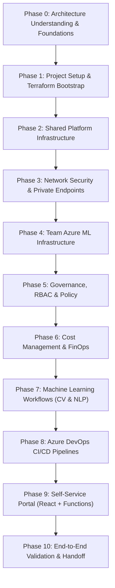

# Implementation Plan & Phase Roadmap

This document outlines the step-by-step master plan for implementing the **Enterprise MLOps Platform**. Every phase has defined objectives, prerequisite checks, key components, and verification gates.

---

## 📅 Roadmap Overview

---

## Phase Details

### Phase 0: Architecture Understanding & Foundations (Current)
- [x] Deep dive into multi-team MLOps topology.
- [x] Shared services vs team workspace boundaries.
- [x] Network security concepts (Customer VNet vs Managed VNet, Private Endpoints, Private DNS).
- [x] DEV → STAGING → PROD model lifecycle flow.
- [x] Review folder structure and state management strategy.

### Phase 1: Project Setup & Terraform Bootstrap (Completed)
- [x] Initialize project directories and structure.
- [x] Configure Azure CLI and verify active subscription / tenant authentication (`a22e5b40-a701-4b0e-b937-b43ed360039b`).
- [x] Provision dedicated Resource Group `rg-mlops-tfstate-poc`.
- [x] Provision Storage Account `stmlopstfdfb9yd` with TLS 1.2, Blob versioning, and 14-day soft-delete.
- [x] Create Blob Container `tfstate`.
- [x] Verify remote state migration and blob leasing / state locking.

### Phase 2: Resource Groups & Networking (Completed)
- [x] Build reusable `resource-group` Terraform module.
- [x] Build reusable `networking` Terraform module (VNet, Subnets, NSG baseline).
- [x] Configure `infrastructure/environments/shared` with remote azurerm backend.
- [x] Provision 8 Resource Groups in Azure: Shared, Network, Team Alpha (DEV, STG, PRD), and Team Beta (DEV, STG, PRD).
- [x] Provision Hub-and-Spoke VNets (`vnet-shared-hub`, `vnet-team-alpha`, `vnet-team-beta`).
- [x] Provision 7 Subnets with MLOps service endpoints.
- [x] Provision 4 Bi-directional VNet Peerings (Hub ↔ Alpha, Hub ↔ Beta).
- [x] Verify remote state stored in `stmlopstfdfb9yd/tfstate/shared.tfstate`.

### Phase 3: Private DNS & Network Security (Completed)
- [x] Build reusable `private-dns` Terraform module.
- [x] Build reusable `private-endpoint` Terraform module.
- [x] Provision 6 Private DNS Zones (`privatelink.api.azureml.ms`, `privatelink.notebooks.azure.net`, `privatelink.blob.core.windows.net`, `privatelink.file.core.windows.net`, `privatelink.azurecr.io`, `privatelink.vaultcore.azure.net`).
- [x] Provision 18 Virtual Network Links across Hub, Team Alpha, and Team Beta VNets.
- [x] Verify DNS link states (`Completed`) and auto-registration setting (`False`).
- [x] Verify remote state committed to `stmlopstfdfb9yd/tfstate/shared.tfstate`.

### Phase 4: Shared Platform Services (Completed in Azure)
- [x] Reusable modules: `monitoring`, `storage`, `container-registry`, `key-vault`, `azureml-registry`.
- [x] Configure Central Log Analytics Workspace (`law-mlops-poc`) & Application Insights (`appi-mlops-poc`).
- [x] Configure Shared Storage Account (`stmlopsshared0vx1e`) with containers: `golden-datasets`, `models`, `code`.
- [x] Configure Shared Container Registry (`crmlopsshared0vx1e` - Premium SKU for Private Link).
- [x] Configure Shared Key Vault (`kv-mlops-sh-0vx1e` with RBAC enabled).
- [x] Configure Central Azure ML Registry (`amlregmlopssharedpoc`) backed by Shared Storage and ACR.
- [x] Configure 3 Private Endpoints in `snet-shared-pe` with Private DNS Zone Groups.
- [x] Verified deployment and remote state committed to `shared.tfstate`.

### Phase 5: Team Alpha & Team Beta DEV Workspaces (Code & Plan Ready)
- [x] Reusable `azureml-workspace` module with SystemAssigned Managed Identity, Key Vault, Storage, and ACR links.
- [x] Reusable `azureml-compute` module with zero idle cost (`min_node_count = 0`, `max_node_count = 1`, `idle_time = "PT120S"`).
- [x] Team Alpha DEV Terraform configuration initialized, validated, and plan saved (`6 to add`).
- [x] Team Beta DEV Terraform configuration initialized, validated, and plan saved (`6 to add`).
- [ ] Cloud `terraform apply` on hold pending subscription spending limit removal.

### Phase 6: STAGING Environments (Code Complete & Validated)
- [x] Team Alpha STAGING Azure ML Workspace HCL (`team-alpha/staging/main.tf`).
- [x] Team Beta STAGING Azure ML Workspace HCL (`team-beta/staging/main.tf`).
- [x] Local `terraform init -backend=false` and `terraform validate` passed (`Success! The configuration is valid.`).

### Phase 7: PROD Environments & Managed Online Endpoints (Code Complete & Validated)
- [x] Team Alpha PROD Azure ML Workspace HCL (`team-alpha/prod/main.tf`).
- [x] Team Beta PROD Azure ML Workspace HCL (`team-beta/prod/main.tf`).
- [x] AzAPI Managed Online Endpoints (`mep-alpha-cv-poc`, `mep-beta-nlp-poc`) with Key auth and TLS integration.
- [x] Local `terraform init -backend=false` and `terraform validate` passed (`Success! The configuration is valid.`).

### Phase 8: Machine Learning Workloads (Completed & Locally Tested)
- [x] Team Alpha (Computer Vision): PyTorch CNN dual-mode training script (`train.py`), accuracy quality gate (`evaluate.py`), and inference scoring (`score.py`).
- [x] Team Beta (NLP): BiLSTM sentiment classification script (`train.py`), accuracy quality gate (`evaluate.py`), and inference scoring (`score.py`).
- [x] Azure ML CLI v2 manifests (`job.yaml`, `model-registry.yaml`, `conda.yaml`).
- [x] Dual-mode verification: All training, evaluation, and scoring scripts executed and passed locally.

### Phase 9: Azure DevOps CI/CD Pipelines (Code Complete & Validated)
- [x] Multi-stage YAML pipelines: `pipelines/team-alpha-pipeline.yml` & `pipelines/team-beta-pipeline.yml`.
- [x] 6 modular templates in `pipelines/templates/`: `validate-dataset.yml`, `train-job.yml`, `evaluate-gate.yml`, `register-model.yml`, `deploy-staging.yml`, `deploy-prod.yml`.
- [x] Automated stages: Data validation -> DEV training -> Quality evaluation gate -> Central registry publishing -> STAGING deployment -> Production approval gate -> PROD deployment.
- [x] All 14 YAML configurations parsed and validated without errors.

### Phase 10: Monitoring, Governance & End-to-End Validation (Completed)
- [x] Production KQL operational queries (`aml_operational_queries.kql`) covering compute scaling, idle detection, latency percentiles (P50/P95/P99), HTTP codes, and failed jobs.
- [x] Azure Monitor Scheduled Query Alert rules ARM template (`metric-alerts.json`).
- [x] Azure Policy definitions for mandatory tags (`enforce-mandatory-tags.json`) and PaaS public access restriction (`disallow-public-access-paas.json`).
- [x] End-to-end automated PowerShell validation script (`scripts/end-to-end-validation.ps1`).
